# World generation: towns, PCG graphs and the shared subgraphs

The eleven town levels (`/Game/Wot/Maps/<Town>`) are generated, not hand-built. A Python **spec** per town describes
streets, plazas, walls, landmarks and NPCs; a deterministic **relief** pass turns that into a stepped voxel terrain with
carved roads, stairs and placement rules; and one **PCG graph** per town spawns everything as instanced meshes. The
point-processing part of every town graph lives in five **shared subgraphs**, so a fix in one of them improves every
level on its next rebuild. This document explains what the pieces do, how the graphs work, and how to build with them.

Images: rendered diagrams live in `docs/images/worldgen/` (regenerate with `pcg_graph_render.py`); the editor
screenshots are also attached to PR #139 (links in the *Gallery* section at the end).

## 1. The pipeline at a glance

```
specs_*.py  ──►  relief.py (terrain, roads, stairs, placement)  ──►  town_builder.py  ──►  PCG graph + hand-placed actors
   │                       │                                              │
   │                       └── house slots, street lines, plaza            └── Create Points data + Static Mesh Spawners
   │                           furniture, terrain boxes, lattice               + the shared PCGS_* subgraphs
   └── roads, plazas, walls, props, NPCs, dialogue, foliage bands
```

Everything runs through the editor's MCP server (launch the editor with `Tools/playtest/editor.sh start`):

| command | what it does |
|---|---|
| `python3 Tools/towns/run_town.py --subgraphs` | (re)build the five shared `PCGS_*` subgraphs in place |
| `python3 Tools/towns/run_town.py --kit` | rebuild the merged voxel kit meshes (`SM_*`: houses, stalls, lamp posts, stairs, foliage) |
| `python3 Tools/towns/run_town.py <Town> ...` / `--all` | regenerate towns: clean the level, build its PCG graph, place props and NPCs, write dialogue rows, execute the graph, save |
| `python3 Tools/towns/run_town.py --dry [Town]` | build the spec and relief locally (no editor) and print counts: boxes, lattice, stairs, lines, furniture |
| `python3 Tools/playtest/nav_rebuild_all.py [Town ...]` | rebuild and save every town's navmesh (always after a town rebuild: the runtime navmesh keeps stale saved tiles) |
| `python3 Tools/playtest/pietest.py <Town> [N] [Seconds] [Interact]` | play-test: walk to the N nearest NPCs, report REACHED / STUCK / NOPATH, talk |
| `python3 Tools/towns/plaza_debug.py <Town> [plaza]` | offline render of a plaza's placement (roads, mouths, footprints, furniture) |
| `python3 Tools/towns/pcg_graph_render.py <graph> <out.png>` | diagram of any PCG graph from its live structure |

A town rebuild takes one to four minutes; `--all` about forty. The CLI stops at the first failing town and leaves that
level open and unsaved for inspection.

## 2. Specs (`specs_a.py`, `specs_b.py`, `specs_common.py`)

A spec is a plain dict built by a function such as `caemlyn_spec()`:

* `roads`: polylines with `width` (lanes of 100 cm tiles), `kind` (`road`, `wall`, `water`, `nobuild`), `closed`,
  `linear`, `keep` (gap ratio), `houses` / `spacing` / `setback` / `sides` / `set` for house slots along it, `lines`
  (street furniture: `lamp_line`, `tree_line`, fences, reeds) and `towers` for walls. Helpers: `grid_streets`,
  `radial_streets`, `circle`, `rect`, `wiggle`, `pier_roads`.
* `plazas`: closed outlines with a pavement material and a `scatter` list `(mesh, ratio, scaleMin, scaleMax, materials)`
  that the placement rules turn into orderly furniture (stalls, lamp posts, monuments, trees).
* `houses` / `house_sets`: mesh/material entries, scale range, keep ratio, footprint; `exclusions`: boxes nothing is
  placed in; `pads`: flattened areas; `props`: hand-placed meshes, actors, NPCs (`npc`, `hero`), chests, potions,
  Waygates (`waygate`); `dialogue`: rows for the dialogue table (`lines`); `foliage`: tree lists and density bands
  (`base_foliage`, `boulders_extra`).
* The terrain: a `Relief` with hills, ridges, valleys, slopes, noise, plateaus (`peaks` for mountain ranges), finished by
  `relief_apply(spec, R, palette)`.

## 3. Relief (`relief.py`): terrain, roads, stairs, placement

`Relief` is a 250 cm cell heightfield quantised to 40 cm steps (one step is always walkable). `relief_apply` runs, in order:

1. hand-placed props **register their footprints** (`register_props`: radius by label/asset, buildings as oriented
   rectangles, landmarks with their own pads none, NPCs only their spawn capsule);
2. `carve_roads`: every road gets a walkable profile (one step per cell), is cut into the terrain and painted into
   `cellmat`; where it meets a terrace edge a **stair flight** is placed (snapped to the real step, shared between roads
   crossing the same edge, slid out of other flights) and both its ground and the upper landing are fixed by
   `finalize_stairs`; walls register as occupied ground and every **gate** (road crossing a wall) is kept clear;
3. `carve_plazas`, `house_pads`: plazas are flattened and painted, house slots get level pads;
4. `road_props`: **house slots** (per set) and **street lines** from the carved profiles, thinned against pavement, stairs,
   doorways and the registry; lines start half a step along the road so nothing sits on a junction corner;
5. `plaza_furniture`: lamp posts at the inset corners / along the edges (or around a round plaza's rim) and around a
   central feature; **market stalls** in rows along the edges facing the middle, back-to-back rows down wide plazas, a
   ring around a well or monument, alternating colour variants; an obelisk in the middle; other scatter on a jittered
   grid. A seat is taken only when free: not on a road through the plaza, not within reach of a street mouth, not on
   another footprint;
6. terrain **boxes** (run-merged cubes per palette material) and the foliage **lattice** (every unpaved cell clear of
   slots, lines, stairs and footprints) are attached to the spec for the graph.

Tunables per spec: `slot_clear`, `slot_spacing`, `slot_stair_clear`, `line_clear`, `line_house_clear`. `plaza_debug.py`
draws one plaza with all of the above so a rule can be tuned without the editor.

## 4. Town graphs (`town_builder.py`): data + spawners

A town graph holds nothing but **data** and **spawners**, laid out in boxed, commented sections and described in its
graph settings ("generated by run_town.py <Town> ... do not edit by hand"):

| section | data nodes | processing | spawners |
|---|---|---|---|
| Exclusions and plazas | hand exclusion boxes, plaza outlines | `PCGS_Plaza` → Surface (exclusion), Tiles | plaza tiles only when asked (the relief paints pavement) |
| Roads, water, walls | road paths, one tile row per lane count | `PCGS_Road` → Tiles, Spline, Samples; Merge per material/kind; `RoadExcl` (tall thin boxes); `WallCut` Difference | piers/bridges/walls spawn tiles; painted roads only feed exclusions |
| Street lines, furniture, towers | relief-placed points | none | one spawner per set |
| Houses | relief house slots | `PCGS_Houses` with the set's jitter/scale/footprint, excluded by roads, plazas, walls, hand boxes and earlier sets | one spawner per set (`bApplyMeshBoundsToPoints`) |
| Terrain | run-merged boxes | none | one spawner per palette material |
| Lattice and foliage | relief lattice, town centre | `PCGS_Lattice` → Ground; one `PCGS_Scatter` per band | one spawner per band |

Because the processing is in subgraphs, a town graph is small (100–240 nodes, most of them Create Points) and every
town reads the same way. Rebuilding a town (`run_town.py <Town>`) recreates its graph from the spec.

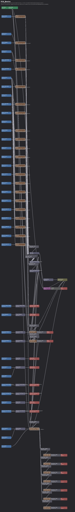

## 5. The shared subgraphs (`pcg_subgraphs.py`, `/Game/Wot/Towns/Common/PCG`)

Each subgraph is built by `pcg_lib.SubG`: extra **input/output pins** on the graph's Input/Output nodes, and **graph
parameters** that a `Get Graph Parameter` node feeds into a node's *Overrides* pin as an attribute named after the
property it overrides (so a parameter overriding `BoundsMin` on two nodes is declared twice with `attr="BoundsMin"`). The
town graph passes values per use as overrides on the subgraph node (`G.sub(graph, name, {param: value})`). Rebuilding a
subgraph happens **in place** (nodes and parameters are cleared and recreated), so town graphs keep their reference and
pick the change up on their next generation.

| subgraph | in | out | parameters |
|---|---|---|---|
| `PCGS_Plaza` | Outline | Surface, Tiles | bLinear |
| `PCGS_Road` | Path, Row | Tiles, Spline, Samples | bClosedLoop, bLinear, DistanceIncrement, KeepRatio |
| `PCGS_Houses` | Slots, Exclusions | Houses | OffsetMin/Max, RotationMin/Max, ScaleMin/Max, Ratio, CoreMin/Max, FootMin/Max |
| `PCGS_Lattice` | Lattice, Center, Exclusions | Ground | OffsetMin/Max, MaximumDistance |
| `PCGS_Scatter` | Ground | Points | LowerBound, UpperBound, Ratio, RotationMax, ScaleMin/Max, BoundsMin/Max |

### PCGS_Plaza
Outline points → closed `Create Spline` (bLinear) → `Create Surface From Spline` (the **Surface** output, used as an
exclusion by houses and foliage) and an interior `Spline Sampler` every 100 cm flattened to 6 cm slabs (**Tiles**).

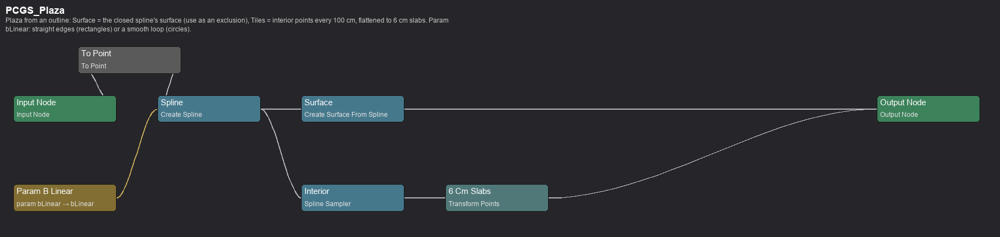
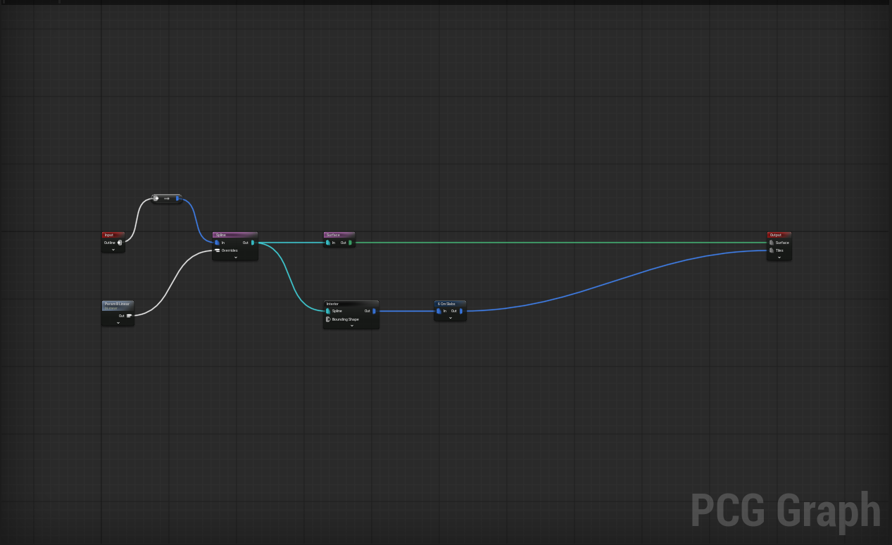

### PCGS_Road
Path points → `Create Spline` (bClosedLoop, bLinear) → `Spline Sampler` every DistanceIncrement → `Copy Points` of the
Row (one tile per lane) onto every sample → `Random Choice` KeepRatio for gaps. Outputs **Tiles**, the **Spline** and the
**Samples**.

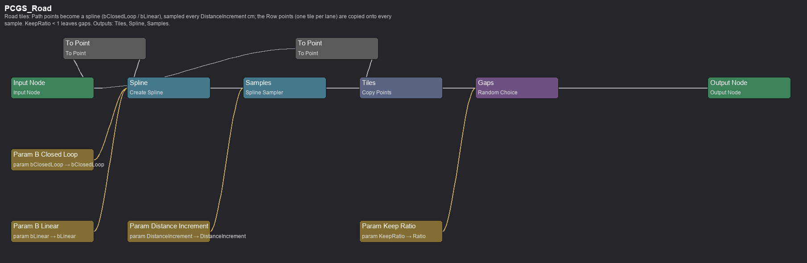
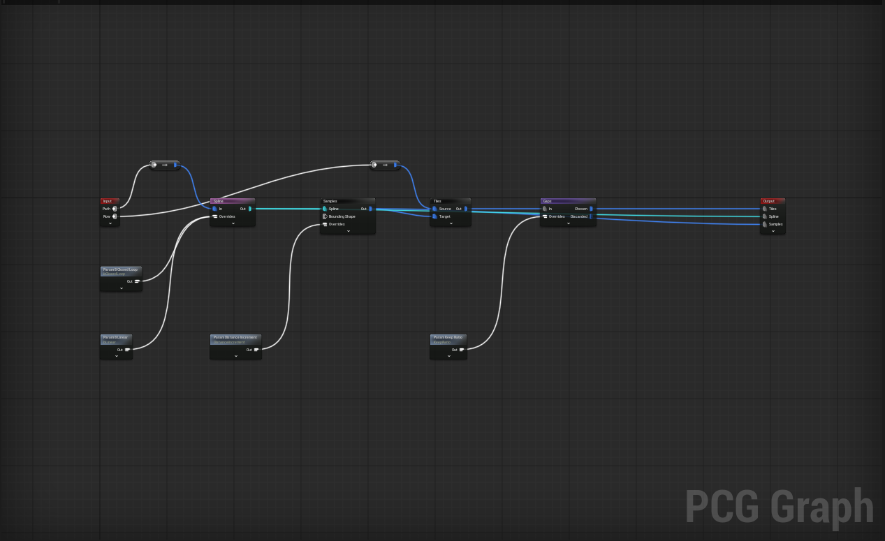

### PCGS_Houses
Slots → `Transform Points` jitter and uniform scale → `Random Choice` Ratio → `Bounds Modifier` core → `Difference`
(binary) against the Exclusions → `Bounds Modifier` footprint → `Self Pruning`. The output points carry the footprint,
so later sets and the foliage treat them as exclusions.

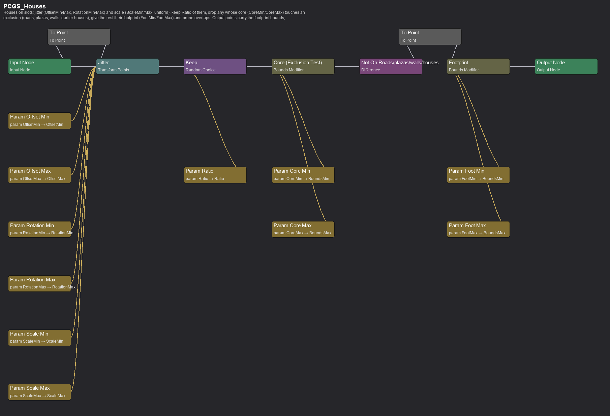
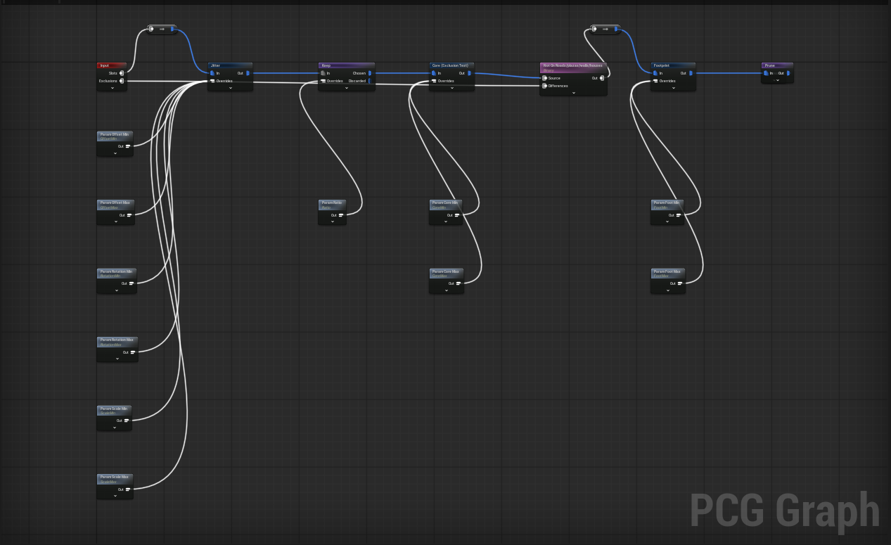

### PCGS_Lattice
Lattice → jitter → `Distance` to the town centre written as density (0 at the centre, 1 at MaximumDistance) → `Difference`
(minimum density) against the Exclusions → **Ground**. Density bands then select where each kind of foliage grows.

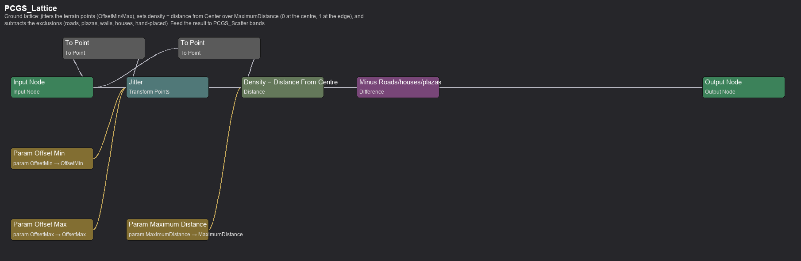
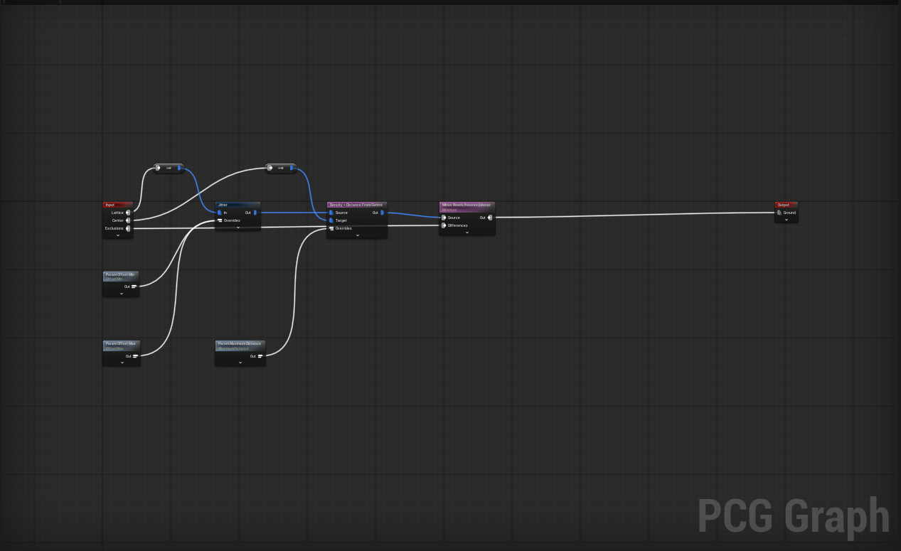

### PCGS_Scatter
Ground → `Density Filter` LowerBound..UpperBound → `Random Choice` Ratio → `Transform Points` (random yaw, uniform scale)
→ `Bounds Modifier` (the prune radius) → `Self Pruning` → **Points** for a spawner in the town graph.

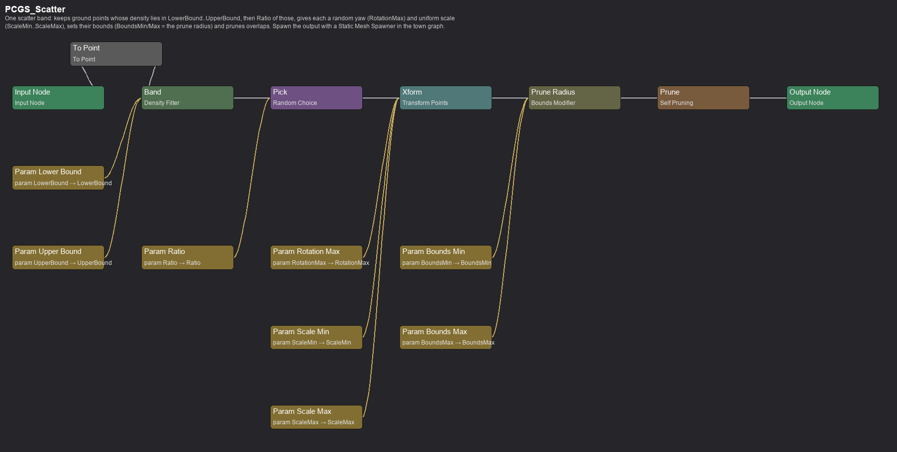
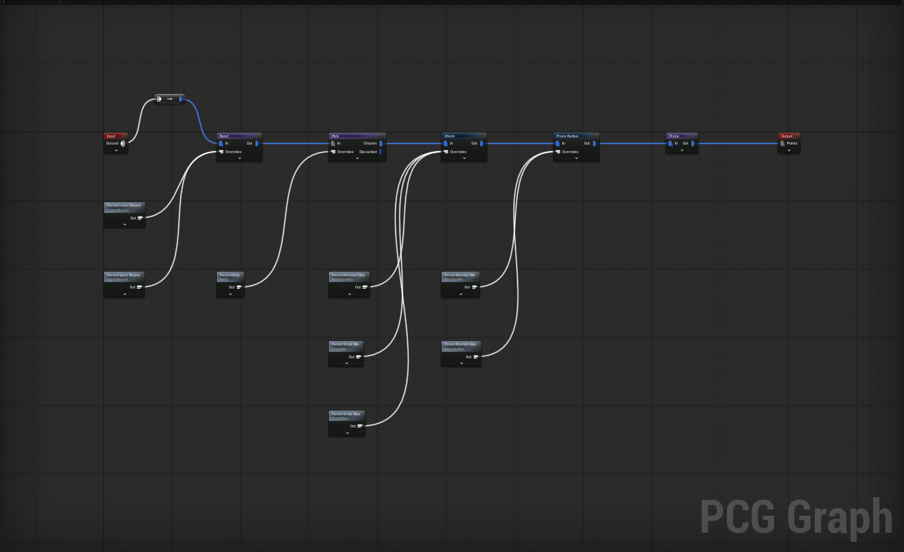

## 6. Collision, navigation and the kit

PCG spawner descriptors default to no collision; `pcg_lib.collision_descriptor` gives every blocking mesh `BlockAll`
and real navigation geometry (navmesh on terrain cubes, tiles, stairs and bridges, carved around buildings and trees;
ground cover stays non-colliding). Stairs meshes use complex-as-simple collision so the navmesh follows the steps. The
kit (`kit_builder.py`, `run_town.py --kit`) assembles houses, stalls, wells, lamp posts, gatehouses, stairs, bridges and
foliage from voxel primitives into merged static meshes under `/Game/Wot/Towns/Common/Buildings` with palette material
instances under `.../Materials`.

**Facing convention.** Every kit building has its pivot at the floor centre and its door on **-X**. House slots along a
street are rotated so +X points away from the road, which puts the door on the street side; hand-placed buildings in
the specs use the same rule (yaw = the direction *away* from what the door should face). The imported Two Rivers house
(`rand_house`) has its door on +X, so the kit wraps it as `SM_RandHouse`: the source mesh re-merged with a half turn,
keeping its five material slots. Street-house entries and the inns use `SM_RandHouse` (`HK` in `specs_common.py`);
footprints in the specs are in this turned frame (`(-740,-420,560,560)` for a full-size house). If a building ever
spawns with its back to the road, check the mesh's door side with `wot.Mesh.Dump <Mesh>` (per-section vertex centroids)
rather than flipping the slot rule.

**Collision.** A merged kit mesh has no collision of its own, so `run_town.py --kit` gives every non-stairs piece convex
hulls (`generate_convex_collisions`, 10 hulls); the PCG descriptors then make the instances `BlockAll`. A house that the
player walks through is a kit mesh without hulls: rebuild it with `--kit SM_Name`.

**Level bounds.** Every town gets a `BP_LevelBounds` actor (the Diorama's fence) sized to the terrain: a box that puts
the player back inside when they leave it. It is placed by `build_level` after the props, tagged `TownProp`, and
replaces any hand-placed one.

**Forageable mushrooms.** The mushroom Blueprints are items (`UWotItem` data), not actors, so the graph does not spawn
them. `build_level` places `WotForagePickup` actors (`Source/.../Items/WotForagePickup`, an interactable item actor that
builds its item from `ItemClass`) on forest-band lattice points at `mush_ratio`, tagged `Forage`, seeded by the town
name. Interacting picks the mushroom up like the Diorama's.

### The building families (art pass, issues #34 #35 #51)

The kit now has regional families, all built from the same box/cylinder DSL and recoloured per town with
`kit_entry(name, {palette: palette})`:

| family | pieces | where |
|---|---|---|
| Two Rivers / Andor timber | `SM_TimberHouse` (thatch), `SM_TimberHouse2` (two storeys, jettied, tile), `SM_TimberHouseSlate`, `SM_TimberHouseShingle`, `SM_ThatchedCottage`, `SM_Barn`, `SM_Smithy` | Emond's Field, Whitebridge, Baerlon, Caemlyn, Fal Dara |
| inns and shops | `SM_Inn` (two storeys, cross wing, dormers, porch, sign, barrels; red tile), `SM_InnThatch`, `SM_Shop` (striped awning, counter of goods, sign board) | the hand-placed inns; markets |
| dressed stone | `SM_StoneHouse`, `SM_StoneHouse3` (quoins, slate, chimney) | Baerlon, Caemlyn, Cairhien, Tear, Tar Valon (white / blue / gold), Illian, Shadar Logoth (blackened) |
| adobe | `SM_AdobeHouse`, `SM_AdobeHouse2`, `SM_AdobeTower` (flat roof, parapet, pergola, outside stair, canvas awning) | Tanchico, Tear's lowlands, the Waste |
| street props | `SM_Cart`, `SM_HayBale`, `SM_Barrel`, `SM_CrateStack`, `SM_FestivalPole`, `SM_Woodpile`, `SM_Signpost`, `SM_Bench`, `SM_FenceSegment`, `SM_FlowerBox` | `market_extras()` in plaza scatter lists; hand-placed on the Green |

`specs_common.py` groups them: `two_rivers_entries()`, `andor_entries()`, `stone_town_entries(wall, roof, quoin)`,
`adobe_entries(wall, trim)`, `market_extras(ratio)`. New palette colours: `P_Straw`, `P_ThatchDark`, `P_Shingle`,
`P_Stone`, `P_Adobe`, `P_Clay` (instances of `MI_VoxelStone`, "Color" parameter).

### The lived-in pass (second round on #34 / #35)

The references are crowded: yards full of things, real carpentry on the frames, roofs in courses, ground cover
everywhere. What changed:

- **Detail on every building.** `_timber_frame` has a sill, mid rail and top plate on all faces, a brace that leans
  the other way in every second bay and a full X every third (braces now tilt in the wall's own plane; they used to
  stick out of it). Windows get a mullion cross, lintel and sill, shutters with an inset panel, flower boxes under the
  top-floor windows. Doors are planked with a handle, a doorstep and a lantern on a bracket. Roof courses alternate
  two shades (`ALT`: `P_Terracotta2`, `P_Slate2`, `P_Straw2` ... darker or lighter twins of the roof colours), with a
  ridge cap, bargeboards on both gables, moss on thatch, a repaired patch on tile, smoke above chimneys, brackets
  under jetties, stone courses in the base. `kit_entry` recolours a roof's twin shade along with it.
- **Yards.** `yard(parts, d, w, seed, fence)` wraps a house in a picket fence, hedge or dry-stone wall with a gate
  gap, a lantern post by the path and a seeded pick of woodpile, barrels, laundry line, trough, vegetable patch, bee
  skep, hen coop, wheelbarrow, bushes, crates and hay: `SM_TimberHouseYard`, `SM_TimberHouse2Yard`, `SM_CottageYard`,
  `SM_CottageDormerYard`, `SM_LHouseYard`, `SM_StoneTimberHouseYard`, `SM_FarmhouseYard`. A house set using them
  needs `"footprint": YARD_FOOTPRINT` (Emond's Field, Baerlon, Whitebridge do).
- **New buildings.** `SM_CottageDormer` (thatch with two dormers), `SM_LHouse` (cross wing), `SM_StoneTimberHouse`
  (stone ground floor, jettied timber upper, dormer), `SM_Farmhouse` (house end and plank byre under one thatch roof),
  `SM_Watermill` (Jon Thane's mill: paddle wheel, race, sluice, flour sacks; on the Winespring brook), `SM_Stable`
  (open stalls by the inn).
- **Yard, field and ground props.** `SM_LaundryLine`, `SM_WaterTrough`, `SM_Wheelbarrow`, `SM_LanternPost`,
  `SM_Hedge`, `SM_StoneWall`, `SM_PicketFence`, `SM_Gate`, `SM_Scarecrow`, `SM_CropRows` (tabac rows in the foliage
  material, so they stir), `SM_Beehive`, `SM_ChickenCoop`, `SM_LogBench`, `SM_Stump`, `SM_FallenLog`,
  `SM_RockSmall`, `SM_FlowerPatch`, `SM_GrassTuft`, `SM_BushRound`, `SM_MushroomCluster`, and two new trees,
  `SM_Oak` (broad lumpy canopy) and `SM_AppleTree` (red fruit), now in `TREES_TEMPERATE`.
- **Density.** `base_foliage` doubles bush and town-tree ratios and raises grass by 1.6, and every town gets
  `ground_extras(biome)` (tufts, flowers, rocks, round bushes, deadfall in the forest band; sparser snow and desert
  mixes). Two Rivers villages add `field_extras()` (crop plots, scarecrows, skeps in the farmland ring). Streets
  take `fence_line(step, offset, sides, mesh)` and `lantern_line()`: hedges and lanterns round the Green, fences
  along the roads out of Emond's Field, dry-stone walls on the lanes; `line_house_clear` keeps them off house
  fronts. Market scatters gained troughs, barrows and log benches.

## 6c. Weather

Every level carries an `Ultra_Dynamic_Weather` actor (`Tools/playtest/weather.py`, preset per town: rain in Tear and
Illian, snow in Fal Dara, blowing sand in Tanchico, ash in Shadar Logoth as the dust preset with near-black particles,
clear skies over Tar Valon and Caemlyn, random variation on the Overworld). Rain, snow and dust spawn around the camera
with collision, cloud cover and fog follow the preset, wind debris (leaves) rides the wind. The voxel base material
(`/Game/Wot/Materials/voxel_subsurface_material_base`, parent of every kit, ground and prop colour) routes Base Color,
Roughness and Normal through UDW's "Snow And Dust Weather Effects" and "Wet Weather Effects" (`wot.Mat.AddWeather`),
with "Material Effects Take Time to Change" on, so snow and dust build up on roofs and ground while it falls and
surfaces darken and gloss in rain, instead of being baked into the meshes (`P_Snow`, `SM_SnowPatch` remain for
permanent drifts). `wot.Mat.Dump <Material>` prints a material's graph.

**Voxel weather particles.** UDW's own sprite rain / snow / dust / wind debris are switched off; the falling things are
`AWotVoxelWeather` (`Source/.../Weather/WotVoxelWeather`), hand-made in the spirit of the fireflies: one instanced cube
mesh per level, little palette-coloured cubes spawned around the player. Rain is long thin blue streaks that splash
flat and vanish; snow drifts down, rests seven seconds where it lands and shrinks away; ash tumbles slowly and settles;
sand blows low and fast across the ground; leaves tumble on the wind and lie a while. `weather.py` picks the kind and
intensity per town (`VOXEL` table) and the wind follows the UDW wind direction; `wot.Weather.Voxel Snow 1` switches it
in a play session. Sizes are tuned for the game's high camera (12 to 25 cm cubes).

**Foliage wind.** Leafy kit parts use the leaf palette (`P_LeafDark`, `P_LeafGreen`, `P_LeafOlive`, `P_LeafPale`),
instances of `voxel_foliage_base`: the base material with UDW's "Foliage Wind Movement" on World Position Offset
(`wot.Mat.MakeFoliage`). Only its medium (branch clusters) and large (whole tree sway) layers are on: the small layer
moves each vertex along its own normal, and voxel meshes have split vertices on every edge, so it tears the faces
apart (`wot.Mat.WireConst ... "Apply Small Movement (Grass / Leaves)" false`). The imported trees and bushes under `Meshes/Foliage/trees|small` were re-parented to
`textured_voxel_foliage_material` the same way (`wot.Mat.SetParent`), so canopies sway with the weather's wind while
houses stay still. Shutters and other green building parts keep the ordinary palette.

**Ground: footprints and puddles.** The town terrain (`MI_Ground_*`, `MI_VoxelGrass`, and `G_Snow` for the snow band)
sits on `voxel_ground_base`: the base material with UDW's "Dynamic Landscape Weather Effects" in place of the prop snow
/ wet functions (`wot.Mat.AddLandscapeWeather <Base> <Copy>` makes it, bypassing the prop functions; the snow and dust
colours are wired in with `wot.Mat.WireConst`, the function's own snow alpha is too faint on flat voxels).
`wot.Mat.CloneMI` re-parents the instances and tags them with the `PM_Ground` physical material. Snow and dust gain
depth with trails, rain leaves puddles with ripples. Every character attaches a UDW "DLWE Interaction" component to each
foot bone at BeginPlay (`WotWeatherFeet::Attach`: `Foot_*` on the humanoid rigs, `leg_*_end` on the voxel rigs), so the
player and NPCs press into Fal Dara's snow and ripple Tear's puddles. Two runtime details make that work: collision
shapes ignore an instanced mesh's override material, so `WotWeatherFeet::TagGround` gives every ground instanced mesh
(material under `voxel_ground_base`) the `PM_Ground` body override once per world; and the render target the trails
draw into follows UDW's control point, which has to be the player *camera* (with the pawn it never recentres, the pawn
spawns after UDW starts). `weather.py` sets that, lists `PM_Ground` on UDW, turns the override-volume target off (no
volumes in the towns) and seeds each level's starting surface state (`MAT_STATE`: Fal Dara snowed in, Tear soaked,
Tanchico dusty) because "Material Effects Take Time to Change" otherwise ramps from bare ground every session.
`wot.Weather.Feet` (what the feet stand on) and `wot.Weather.MPC` (UDW's material parameter collection, settable) are
the diagnostics. The Overworld landscape material is emissive-driven (the map texture) and keeps no surface effects.

**Water: flow lines, ripples, falls.** `AWotVoxelWater` (`Source/.../Weather/WotVoxelWater`), one per level from
`weather.py` (`WATER_FLOW` gives each town a downstream hint), is the water's own voxel particle system. At BeginPlay
it finds every water voxel (instanced meshes whose material is `MI_VoxelWater`, big tiles split into 200 cm cells),
works out the local run of the water per cell (principal axis of the neighbouring cells, signed by the hint) and
notes fall edges (a neighbour more than 150 cm lower). Then pale flat streaks drift downstream over every surface
and fade in and out, flecks pour over the fall edges, and anyone whose feet are under a surface gets rings of
flecks spreading out from them (fast rings and a few kicked-up drops when they move, slow ones when they stand).
`wot.Water.Status` logs what it found. Waterfalls themselves come from `waterfall(label, x, y, yaw, z_top, z_bottom)`
in `relief.py`: the top emitter on the lip, a sheet of voxel water the whole drop, foam where it lands and a smaller
foam at the lip (the Winespring: lip at relief 480, brook at -160).

**NPCs and rebuilt towns.** Villagers and heroes are hand-placed by coordinate while the houses are generated, so a
rebuild can drop a house on top of one. `AWotAICharacter::BeginPlay` projects the start point to the navmesh with a
tight extent and, if that fails, steps the NPC out to the nearest navigable spot within 14 m (logged as `[NPC]`).

**Coplanar faces.** Two kit parts that share a face plane z-fight (frame rails crossing posts, pickets on rails, a
slab resting exactly on another). The rule in `kit_builder.py`: every member stands a different distance proud of
its wall (posts 11, braces 12 / 14, rails 13, corners 14 cm), trims sink a few centimetres into what they sit on
rather than touching it, and nothing is built as a slab hidden inside a solid.

## 6b. The Overworld portals

The Overworld terrain is a landscape whose PCG graph (`PCG_Landscape`) samples `blender/overworld-full.png` through a
Get Texture Data node: the texture is mapped onto a surface centred on the `BP_LandscapeLayers` actor with half-size =
its spline bounds and advanced tiling (0.29, 0.30) / centre offset (0.27, -0.16), which places texel (0,0) at
(-13271, -17662) and the far corner at (17653, 13911). The texture itself is a cut of the reference map
`maps/newwotbase-1.png` (texel = base pixel (620 + 9.2 c, -120 + 9.2 r), found by matching the sea masks), and
`ow_cities.json` holds the city icon centres read off that map (a black star in a white ring for cities, a black dot for
towns). `Tools/towns/ow_fit.py` chains the two transforms, moves a town onto a hand-placed settlement when one is within
1500 cm (`ow_houses.json`, exported by `ow_houses.py`), and writes `ow_sites.json`; `run_town.py --overworld` then
places or moves the portals, player starts and landmarks. Cities without a level yet (Falme, Ebou Dar, Far Madding,
Amador, Bandar Eban, Jehannah, Lugard, Chachin, Maradon) get a disabled marker portal; Mayene and Fal Moran lie east of
the cut and are skipped, Fal Dara is held at the landscape edge. Check a fit by drawing `ow_sites.json` and
`ow_houses.json` over the texture with the same transform.

## 6d. Overworld2: the voxel diorama

The second Overworld (`/Game/Wot/Maps/Overworld2`) is the issue #35 / #51 "diorama" reading of the map, built beside
the old landscape level so the two can be compared. `Tools/towns/ow_voxel.py` (Pillow + numpy, `python/env`) classifies
every texel of `blender/overworld-full.png` into sea, coast sand, grass, meadow, dry plain, forest, hill skirt,
mountain and snow, resamples that to 1 m cells on the same texture-to-world mapping the old level used (`ow_fit.py`),
and gives each cell a terrace: mountains rise one voxel per two texels into their mass (2 to 9), snow from terrace 7,
hill skirts 1, two gentle terraces roll across the plains, the sea sits two below. Rows of equal material and height
run-merge into slabs, with a darker strata slab wherever a neighbour is lower, so coasts and mountains read as stepped
cliffs; the sea is one slab of voxel water. Trees are the kit's oaks, round bushes and pines, dense on the forest mask
and sparse elsewhere, scaled to the table. `ow2_build.py` (`run_town.py --overworld2`) copies the Overworld level, strips
its landscape, mountain / tree props and foliage houses, spawns the slabs and trees through `PCG_Overworld2`, sets the
portals, player starts, landmarks, enemies and the hand-placed settlement houses (`ow_houses.json`) on the new ground,
and fences the table with a level-bounds box. The editor's `read_file` tool takes 80 KB a call, so `ow_voxel.py` stages
its JSON as numbered parts under `Saved/PlayTest/ow_voxel_parts` (regenerate: run `ow_voxel.py`, then the build).
Rivers, roads and lakes come from the base map `maps/newwotbase-1.png` through the same texel mapping (`BX, BY, SX,
SY` in `ow_voxel.py`): rivers are its thin saturated-blue lines (runs of 12+ cells; filled blobs are sigils, short runs
lettering), carved one terrace into whatever they cross with voxel water on top; roads are its dotted brown lines
(dots on open country only, the borders' red told apart by its blue level, runs of 15+ cells), a dirt line at ground
level; lakes are enclosed sea-class cells, set one terrace below their shore instead of two. The tiny cities
(`kit_builder.py`: `SM_Tiny_<Town>` for the eleven towns, `SM_Tiny_City` / `SM_Tiny_City2` for the cities without a
level) stand beside each portal: Caemlyn's white Inner City on its hill, Tar Valon's island and Tower, the Stone of
Tear, Cairhien's topless towers, Illian's canals, Tanchico's round harbour, Fal Dara's keep, Shadar Logoth's
blackened ruin, Baerlon's wall and gate, Whitebridge's bridge, the Green and inn of Emond's Field.
Cost: about 29,000 slab instances and 2,100 trees, 2 M LOD0 triangles, against the old level's 12,000 Nanite props and
19 M. The settlement clusters (`ow_houses.json`) are map-scale kit houses too (`SM_Tiny_House`, `_House2`, `_House3`,
`SM_Tiny_Barn`). Top slabs are merged into 2D rectangles (a row run grown downwards while the rows below match), and
every Overworld2 spawner entry has `bAffectDistanceFieldLighting` and `bAffectDynamicIndirectLighting` off: with tens
of thousands of instances the global distance field and the Lumen scene re-track them on every camera move, which is
what made flying the level in the editor crawl (shadows stay). `wot.Perf.Primitives [N]` lists a world's heaviest mesh
components and `wot.Perf.Frame [seconds]` logs average frame and GPU milliseconds in a play session; driven from the
harness the editor does not render between commands, so those readings only mean something with the editor in front.
Still to do: subtler meadow patches.

### Dense town rows (second round on the #35 town references)

The references pack houses shoulder to shoulder in rows of mixed height. `row_houses(n, seed, ...)` in `kit_builder.py`
builds one kit mesh of 3 to 5 houses sharing party walls along Y, each with its own storeys (2 or 3), wall colour,
roof, jetty, dormer and chimney, a frame only on the street face, and lit windows (`P_GlassLit`: the glass instance with
a warm "Emissive Color"); a barrel, crates and a hanging sign sit against the fronts. `SM_Row3/4/5`, `SM_RowStone4/5`,
`SM_RowTimber3/4` go into `row_set(entries)` house sets (slots 1900 apart, footprint (-520,-900,260,900)):
`ROWS_TIMBER` on Baerlon's main street, Cairhien's foregate and Tear's dock alleys, `ROWS_STONE` in Caemlyn's alleys,
`ROWS_WHITE` in Tar Valon's quarter.

## 7. Building with it: recipes

* **Change a rule for every town** (stall spacing, lamp clearance, house jitter): edit `relief.py` (placement) or the
  subgraph in `pcg_subgraphs.py` (point processing), run `run_town.py --subgraphs` if a subgraph changed, then
  `run_town.py --all` and `nav_rebuild_all.py`. Check with `--dry` first; it prints counts in a few seconds.
* **Change one town**: edit its spec, `run_town.py <Town>`, `nav_rebuild_all.py <Town>`, `pietest.py <Town>`.
* **Add a town**: write `<town>_spec()` next to the others, add it to `CITY_SPECS` and `TOWNS`, create the level from
  the template (see `run_cities.py`), then build as above.
* **Add a kit piece**: a function in `kit_builder.py` returning voxel boxes (door on -X, pivot at the floor centre),
  registered in its table; `run_town.py --kit SM_Name` builds just that mesh. A part whose material is `None` wraps an
  existing mesh asset as-is (see `rand_house`).
* **Add a plaza furniture kind**: `plaza_furniture` keys on the mesh name (`MarketStall`, `LampPost`, `Obelisk`, other);
  add a layout branch there and the footprint radius in `FOOT_RADIUS`.
* **Debug placement**: `plaza_debug.py <Town> <plaza>` and `audit_stairs.py <Town> -v`; **debug a graph**: open it in the
  editor (sections are boxed and commented) or `pcg_graph_render.py`.
* **Never** patch PCG `MeshEntries` in place from `get_properties`: unloaded soft material references read back as None and
  wipe the material overrides. Change `pcg_lib` / the spec and rebuild.

## 8. Gallery (PR #139 attachments)

The same images, hosted on the PR for anyone without a checkout:

Gallery comment: https://github.com/Well-known-Game-Studio/wot_a_good_game/pull/139#issuecomment-6234831370

* [Baerlon town graph (editor)](https://github.com/user-attachments/assets/17c007f8-1612-4957-9ad0-fcb18ff3ed43)
* [Baerlon town graph (diagram)](https://github.com/user-attachments/assets/e1a54baf-6a65-4ea8-b36b-d708ad9d329e)
* [PCGS_Plaza (editor)](https://github.com/user-attachments/assets/8b03f10b-bf0c-4357-b3d2-33db10fe4803)
* [PCGS_Plaza (diagram)](https://github.com/user-attachments/assets/19977370-fe4d-46ff-b08b-51fffef4039a)
* [PCGS_Road (editor)](https://github.com/user-attachments/assets/68f79cd8-86bf-4231-a45d-9e1d45c45ac4)
* [PCGS_Road (diagram)](https://github.com/user-attachments/assets/61e548f4-23de-4bf6-aa77-416f57a425bb)
* [PCGS_Houses (editor)](https://github.com/user-attachments/assets/41db6219-7a55-464a-8e2c-0a6a94739dff)
* [PCGS_Houses (diagram)](https://github.com/user-attachments/assets/c5247649-cde5-4d2f-acbe-bac2da76f67c)
* [PCGS_Lattice (editor)](https://github.com/user-attachments/assets/38feb342-0197-451b-9bb2-1d4f5d6c19cd)
* [PCGS_Lattice (diagram)](https://github.com/user-attachments/assets/34c239e8-dd52-4f61-a8e2-5d3791c03d69)
* [PCGS_Scatter (editor)](https://github.com/user-attachments/assets/cbead8de-13d1-4aac-9dc1-c0b91cae3757)
* [PCGS_Scatter (diagram)](https://github.com/user-attachments/assets/942c5cfc-03a1-4411-a7c1-bc6bde2a1366)

